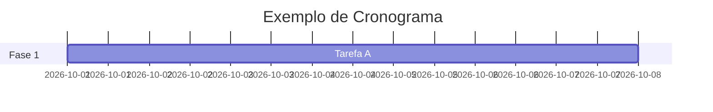
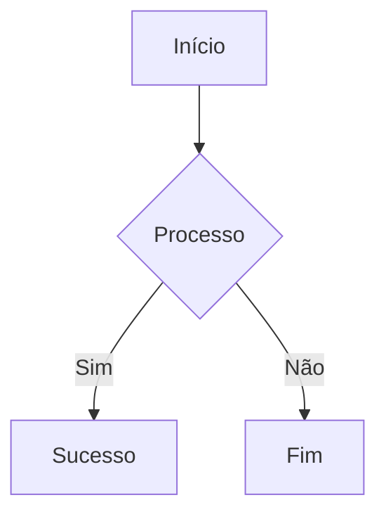
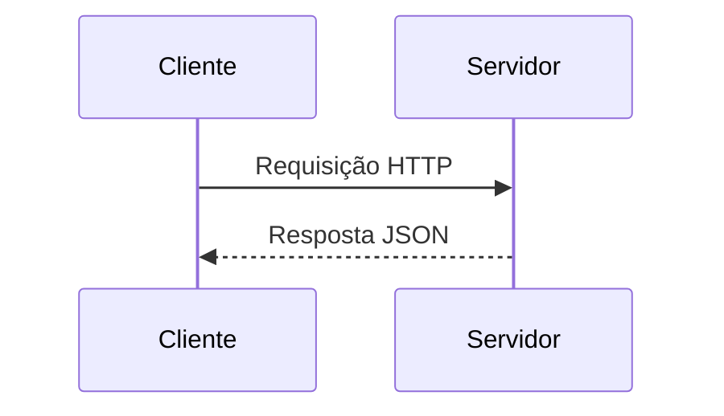
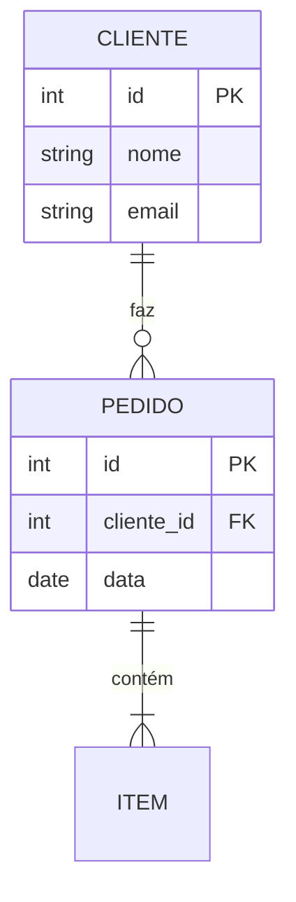
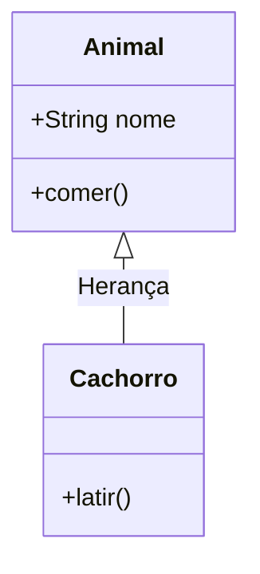

# NOSQL
> pegar e colocar outras regras aqui
> todo comando começa com **db.** Nome_da_coleção

Glossário

.updateOne()
.updateMany()
.find()
.insertOne() - criar


> Lembrar de quando for criar array, colocar entre chaves []. Ex: competencias:['exemplo1','exemplo2']


## Comando find

### Pesquisa simples 
find({1},{2})
{1} -> where filtro (seleção) 
{2}-> É a projeção

campo: valor -> Igual ($eq:) //pode ser omitido, é implícito com campo:
$lt: -> menor que
$lte: -> menor igual
$gt:  -> maior 
$gte: -> maior igual
$ne: -> diferente de

### Exemplo de pesquisa + ($eq:)
db.funcionarios.find({nome: 'Ana Silva'})

### Pesquisa com filtro para apenas nome e idade 
**(lembrar que é binário, ou seja, tenho que colocar 1 quando quero trazer e 0 quando tirar (ex: tirar o ID que vem padrao)**

db.funcionarios.find({nome: 'Ana Silva'}, {nome:1, idade:1, _id:0})

### Pesquisa de 'todos os funcionarios' com 'nome e data'

db.funcionarios.find({}, {nome:1, idade:1, _id:0})
- O campo de filtro tem que ser colocado como vazio para sinalizar que nao tem a seleção, ou seja, pega tudo do documento

## Update

### $Set(definir/modificar um campo) -- atualiza ou insere
{where},{valor e dado //esqueci o nome}

db.funcionarios.updateOne({nome: 'Daniel Farias'}, { 
  												$set: {cargo: 'Cientista de dados' ,
                                 salario: '7800.00'}})

### $unset (Remover um campo)
{$unset: {"contato.telefone": ""}}
//precisa deixar a sintaxe correta seguindo chave - valor ou coluna-valor.
//Ou seja, deixar, o "" representa o campo cumprindo a sintaxe.

db.funcionarios.updateOne({nome: 'Daniel Farias'}, {$unset: {cargo: ""}})

qando objeto //talvez igual subquery. ex contato.telefone, usa dotação (ponto) 

Toda vez que falar de algo que está dentro de um subdocumentos, usa-se dotação -ponto- (ex: contato.telefone)
e quando for referenciar (ex: $unset) tem que usar aspas.

```
exemplo e diferença:
db.funcionarios.updateOne({nome: 'Daniel Farias'}, {$unset: {cargo: ""}})
db.funcionarios.updateOne({nome: 'Daniel Farias'}, {$unset: {"contato.telefone": ""}})
```
***Quando tempos a dotação (um subdocumento), é um objeto. Se temos
Documento: ['Doc1', 'Doc2', 'Doc3'] é chamado de array
Documentacao{
  Documento: 'Doc1' } é chamado de objeto/subdocumento***

## Renomear Coluna (acho)

db.funcionarios.updateMany({},{$rename: {"habilidades": "competencias"}})

> Verificar as funções que to usando (updateOne, updateMany)

## Incremento e decremento

$inc 500 
$inc -500

db.funcionarios.updateMany({},{$rename: {"habilidades": "competencias"}})

## Multiplicação

$mul

db.funcionarios.updateMany({},{$rename: {"habilidades": "competencias"}})

# Aula 07/10 - continuação 

> Set é para trocar o valor. Rename é para trocar um campo

#### Trocando documento Habilidades por Competencias

db.funcionarios.updateMany({},{$rename:{'habilidades':'competencias'}})

### Adicionar e remover um Elemento de um Arrray

$push **adiciona** um elemento dentro de um Array. Com o set, trocaria tudo por um valor só.
Não há verificação se existem elementos duplicados ou não.

$pull **remove** um elemento dentro de um array

db.funcionarios.updateOne({nome:'Ana Silva'}, {$push:{competencias:'TypeScript'}})

db.funcionarios.updateOne({nome:'Carla Dias'}, {$pull:{competencias:'Jira'}})

### Remover o primeiro ou ultimo elemento de um array

$pop identifica se é o primeiro ou ultimo com 1 ou -1

> O 'ultimo' é o mais recente (quando fez o push, foi pro final)

db.funcionarios.updateOne({'Daniel Farias', {$pop:{competencias:-1}})


### Adcionando elemento apenas se não existir

$addToSet verifica se não existe o elemento no array. Se nao existir, adiciona.

db.funcionarios.updateOne({nome:"André Marques"}, {$addToSet:{competencias:"React"}})

### Deletando 
.deleteOne()

db.funcionario.deleteOne({nome: 'Eduarda Lima'})

## faltei dia 14

## dia 15

procurando 5 maiores em ordem decrescente

db.pokemon.aggregate(
[
{$sort: {attack:-1}},
{$limit: 5}
{sort:{name: 1}}
]
)

#### Projetando - é em binário (1 verdadeiro 0 falso)
{$project:{_id:0, name:1, attack:1}} //mostra só isso

#### seleção

{$match: {defense: {$ gt:60} 
             speed:{$lt: 50}
            }
    }

#### Novos

##### UNWIND
'Quebra um array', gerando documentos novos. Só para "transformação". Se tiver 3 documentos, com 2 tipos, ele quebra, ficando mais rapido e facil de manipular.

valores dentro de um array --> usar unwind

{$match: {_id:15}},
    {$unwind:"$types"}
  ]
)
//procura o id 15, e quebra o array 'types' em documentos. (pq usa "$types" com aspas duplas e s/chave)


##### $GROUP -- parecido com groupby

"resumir algo.. "quantos pokemons do tipo dark?"

-Sempre que for usar funções de agrupamento, e estão baseadas em alguma informação dentro de um array, o UNWIND DEEVE vir antes para quebrar.

- $Group sempre terá _id. Esse _ID não é do pokemon, é de quem quer agrupar (?) é o "by"

ex: 
db.campeoes.aggregate([
      {$group:{_id:"$funcao", qtde_funcoes: // o agrupamento, a coluna que está querendo agrupar e o apelido, respectivamente.
      {$sum:1}} //nao tem count. por isso o sum
      }])

-sifrao antes da funcao(nome coluna) é para indicar que é um campo. qtde_funcao nao tem sirao, indicando que é um apelido.


{$match: {_id:15}},
    {$unwind:"$types"}
  ]
)

####lookup


---










